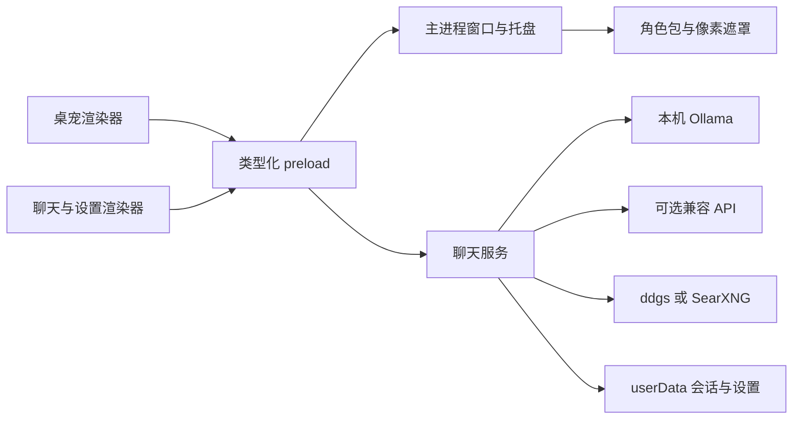

# 月亮茶屋桌宠设计与验收

桌宠在 Windows 桌面上播放本地 PNG，托盘管理窗口与装扮。角色聊天优先调用本机 Ollama，用户主动启用搜索时才发送搜索词。素材来自本项目的月亮茶屋角色包，聊天内容由用户输入，联网结果由所选搜索服务返回。

| 编号 | 类别 | 可观察的验收条件 |
|---|---|---|
| A01 | 核心 | 启动后出现透明桌宠与托盘图标，桌宠在普通窗口上方。 |
| A02 | 核心 | 点击透明区域能点到下层窗口，点击不透明轮廓内触发动作。 |
| A03 | 核心 | 按住角色拖动能移动窗口，过程中播拖拽帧，释放回待机。 |
| A04 | 核心 | 在角色上滚轮缩放保持 1:1，缩放前后腰线尽量保持在原位置。 |
| A05 | 核心 | 托盘按月铃与橘栗分组列出 7 套内建服装，换装后刷新动作和头像。 |
| A06 | 核心 | 从托盘触发任一短动作，单次动作结束回待机。 |
| A07 | 核心 | 单击打开相邻聊天窗，关闭聊天窗后保留桌宠和托盘。 |
| A08 | 核心 | Ollama 可用时，回复逐块出现，输入与回复保存到当前角色历史。 |
| A09 | 核心 | 同一角色换装保留会话，切换角色显示该角色独立历史。 |
| A10 | 核心 | `/search 关键词` 或搜索开关触发查询，有结果时显示来源。 |
| A11 | 核心 | 托盘可隐藏、恢复和退出，设置可导入使用有效 manifest 的角色包。 |
| A12 | 边界 | 窗口尺寸限制为 80–400 DIP，显示区改变后桌宠仍可找回。 |
| A13 | 异常 | Ollama 无模型、无法连接或模型已删除时，聊天提示配置，桌宠继续运行。 |
| A14 | 异常 | 空消息、超长消息、重复发送和搜索服务失败得到明确处理。 |
| A15 | 异常 | 角色包路径越界、关键动作帧缺失或遮罩无有效白像素时拒绝加载。 |
| A16 | 非功能 | 未启用云端和搜索时，聊天只请求本机 Ollama，渲染器通过固定 IPC 通道访问。 |
| A17 | 非功能 | 重启后恢复服装、大小、位置和设置。安装版可由用户开启登录启动。 |
| A18 | 非功能 | Windows 分发包可在未安装 Node.js 的机器启动桌宠。 |
